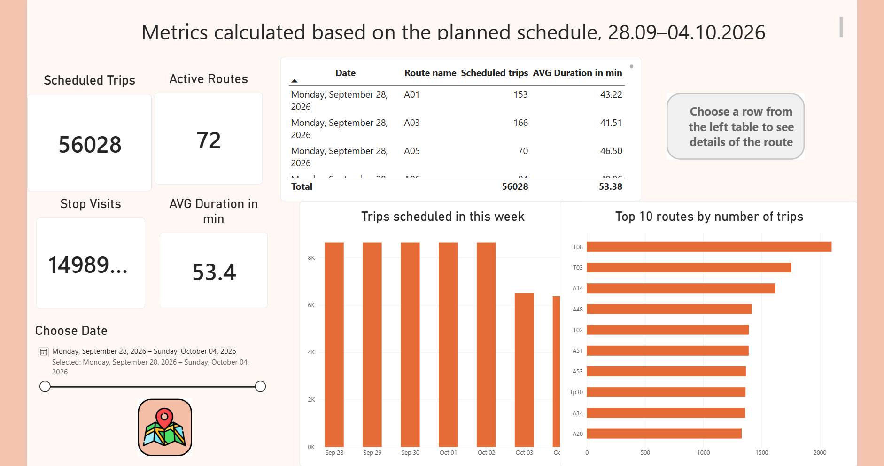
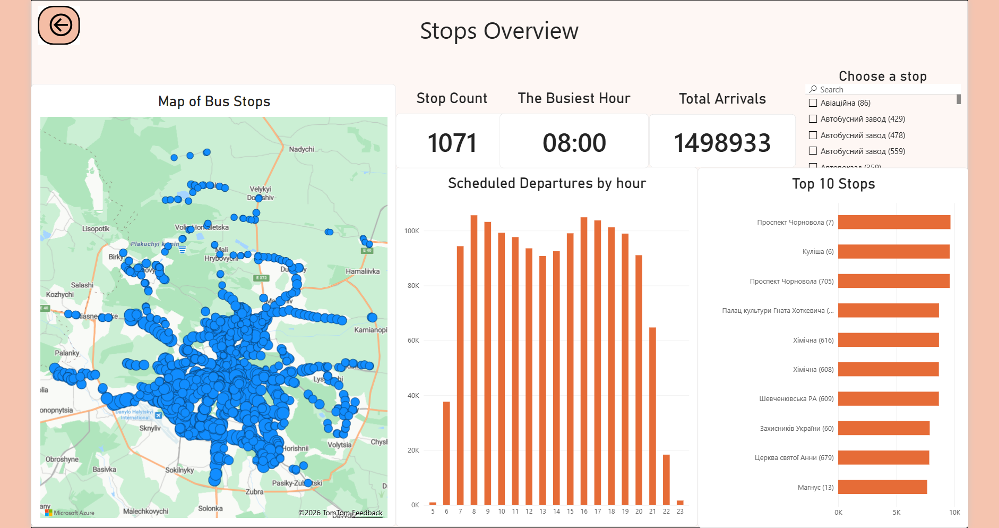
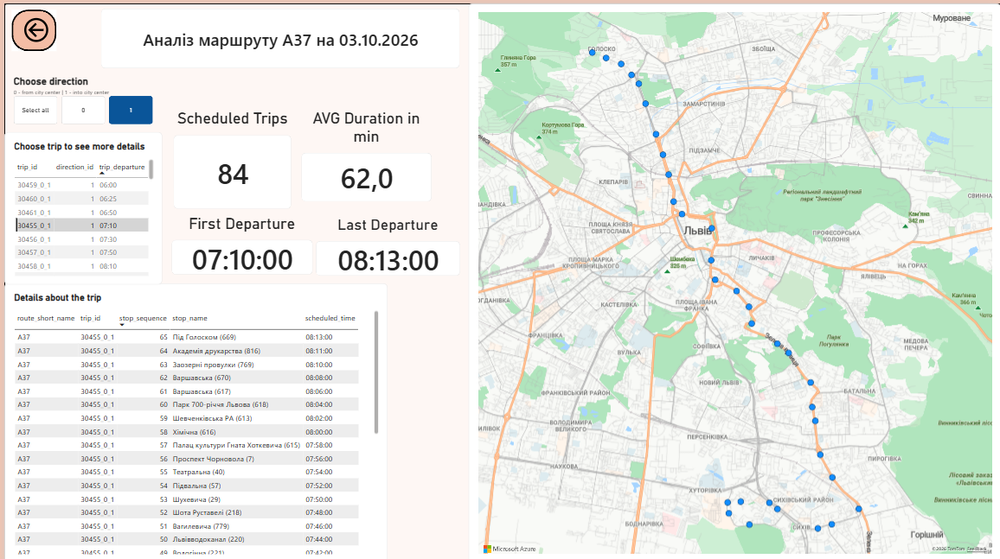
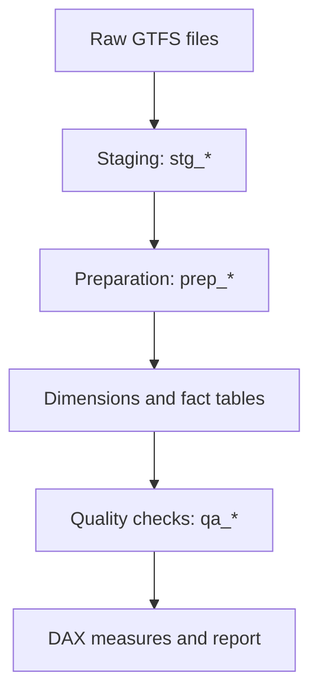
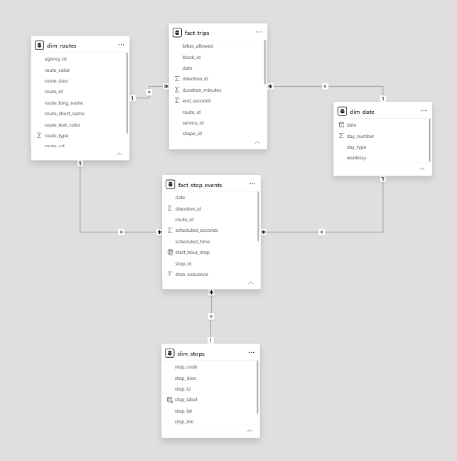

# Lviv Public Transport — Power BI

A Power BI project exploring scheduled public transport service in Lviv: route activity, stop coverage and individual trip schedules.

**72 routes · 56,028 scheduled trips · 1,498,933 stop visits**  
Analysis period: **28 September – 4 October 2026**.

[**Open the Power BI report →**](https://app.powerbi.com/groups/me/reports/760b8813-a683-4362-ad6d-1cbc90843dbd?ctid=7631cd62-5187-4e15-8b8e-ef653e366e7a&pbi_source=linkShare&bookmarkGuid=6606c260-01e7-4e77-8995-38f0f8f7448f)

_The report link requires Power BI sign-in and appropriate access permissions. Screenshots below provide a quick preview._

## Report preview

**Overview** — network KPIs, daily service and route comparison.



**Stops Overview** — stop locations, busiest stops by scheduled visits and departures by hour.



**Route Details** — select one date and route from the Overview table, then choose a trip to explore its stops in travel order.



## Key findings

- Weekdays have **8,632 scheduled trips per day**. Saturday has **6,504**, and Sunday **6,364** — an average weekend day has **25.5% fewer trips** than a weekday.
- **1,064 of 1,071 stops** have scheduled visits during the analysis week.
- Average scheduled trip duration is **53.38 minutes**, excluding trips with unknown duration.

These figures describe the planned timetable, not actual arrivals, passenger demand or delays.

## Data preparation and model

**Tools:** Power BI, Power Query (M), DAX; supplemental SQL checks of model data.

GTFS files are cleaned in staging queries, prepared into stop times and active service dates, then loaded into a dimensional model. Transformations include data typing, joins, grouping, date expansion and conversion of scheduled time to seconds.

### Data cleaning pipeline



1. **Import and standardize — `stg_*`**  
   Import GTFS files, assign data types, and trim/clean text fields. Keep identifiers as text and coordinates as decimal numbers. Preserve missing optional values.

2. **Prepare stop times — `prep_stop_times`**  
   Select trip, stop, sequence and scheduled-time fields. Convert `HH:MM:SS` into seconds for duration calculations, while retaining the original time text for display.

3. **Expand service dates — `prep_service_dates`**  
   Match operating weekdays and calendar validity periods to the analysis dates, producing one row per active `service_id` and date.

4. **Build the model — `dim_*` and `fact_*`**  
   Create date, route and stop dimensions. Group stop times by trip to calculate stop counts and first/last scheduled times. Combine trips with active dates to build `fact_trips`, then join to stop times to create `fact_stop_events`.

5. **Validate data — `qa_*`**  
   Check key uniqueness, missing required identifiers, unmatched references and row counts after joins. Retain scheduled trips without stop times, leaving their unknown duration and departure time blank.



| Table            | One row represents                               |
| ---------------- | ------------------------------------------------ |
| dim_date         | One date                                         |
| dim_routes       | One route                                        |
| dim_stops        | One stop                                         |
| fact_trips       | One trip on one date: `(date, trip_id)`          |
| fact_stop_events | One stop visit: `(date, trip_id, stop_sequence)` |

Dimensions filter facts through five active, one-to-many relationships. There is no direct relationship between the facts.

The reviewed model has no duplicate or null logical keys and no unmatched dimension references. **45 dated trips lack stop times**; they remain in the scheduled-trip count, with unknown time and duration values preserved. SQL checks supplement the Power Query pipeline; SQL is not the report's data source.

## DAX example: show details for one selected trip

This measure is used as a visual-level filter (`Show_Trip_Table = 1`) on the stop schedule table.

```dax
Show_Trip_Table =
VAR valid_selection =
    CALCULATE(
        HASONEVALUE(dim_routes[route_id])
            && HASONEVALUE(dim_date[date])
            && HASONEFILTER(fact_stop_events[trip_id])
            && HASONEVALUE(fact_stop_events[trip_id]),
        ALLSELECTED()
    )
RETURN
    IF(
        valid_selection
            && COUNTROWS(fact_stop_events) > 0,
        1,
        0
    )
```

`CALCULATE` with `ALLSELECTED()` evaluates the selection outside the detail table's individual row context. `HASONEVALUE` requires one route, date and trip, while `HASONEFILTER` requires one directly filtered trip ID. The final `COUNTROWS` keeps only rows with matching stop events. The measure filters table rows; it does not hide the visual container or identify which visual supplied a filter.

## Future improvements

- Match the separate **2024 stop-accessibility dataset** to GTFS stops using validated identifiers and location checks; display the source year, match coverage and unknown statuses.
- Draw street-level route paths using GTFS `shapes` data. The current map displays stop locations.
- Improve report accessibility through alt text, keyboard tab order and contrast.
- Parameterize source paths and analysis dates, and support calendar exceptions in future feeds.

Data format: [GTFS Schedule Reference](https://gtfs.org/documentation/schedule/reference/).
